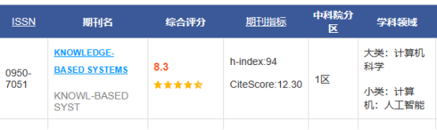
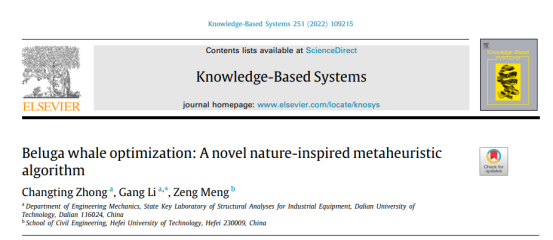
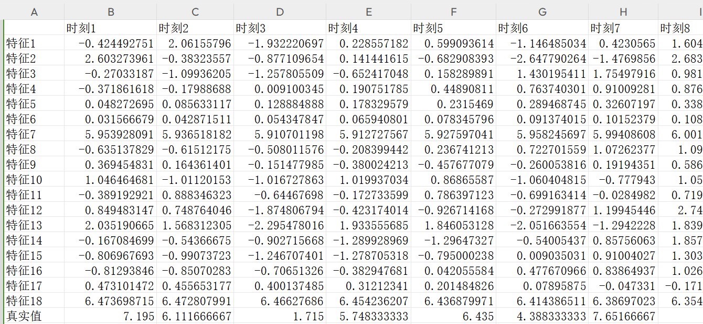
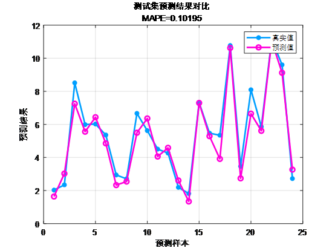
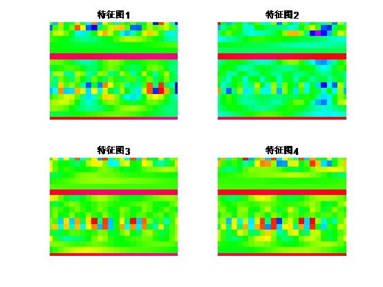
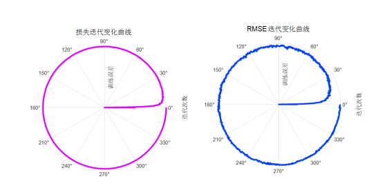
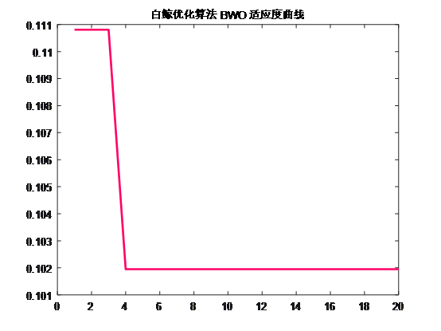

# JCR1 Zone: BWO-CNN-BiGRU-Attention Fusion Attention Mechanism Regression Prediction Program, directly run! Highly innovative!

Applicable Platform: Matlab 2023 version and above.
BWO, White Whale Optimization Algorithm, was published in the journal Knowledge-Based Systems in 2022. The attachment includes references.
\n        \n  
\n        \n      Code Description: A predictive algorithm for multivariate time series regression based on the Baikal Optimization Algorithm (BWO), Convolutional Neural Networks (CNN), and Bidirectional Gated Recurrent Unit networks (BiGRU) that incorporate attention mechanisms, with a lead-time of 24 steps.
Function:
1. Input multiple variable features, output single sequence variables, input the features of the previous day to achieve prediction for the next day, with a lead-time of 24 steps.
2. Optimize the learning rate, convolutional kernel size, and number of neurons through the BWO optimization algorithm, aiming to minimize MAPE as the objective function.
3. Provide polar coordinate plots of loss and RMSE iteration changes; network feature visualization graphs; test comparison graphs; fitness curve (if the initial accuracy is the highest, then the fitness curve is a horizontal line).
4. Provide results display for MAPE, RMSE, MAE, etc.
Applicable fields:
Applications include wind speed forecasting, photovoltaic power forecasting, power generation forecasting, and carbon price forecasting.
Convenient to use:
Directly import data into the Excel table without requiring significant modifications to the program. The internal comments are detailed and easy to understand.
Data example:
The previous day, 18 meteorological features were sampled over a 24-hour period, with the output being the power output for the next day's 24 hours. This is equivalent to an input of 18×24 and an output of 1×24, totaling 75 such samples.
\n        \n  
Predicted vs. actual values:
\n        \n  
Training feature visualization:
\n        \n      Polar form of training error curve (error approaching 0 from inside to outside)
\n Adaptation curve:
\n        \n  

## Images

<!-- PAYMENT_BLOCK -->

## Get this dataset

- Payment link (Stripe): [Buy now](https://buy.stripe.com/3cs8yP7sY87d0vu9AB)
- Payment QR code: 

<!-- /PAYMENT_BLOCK -->
